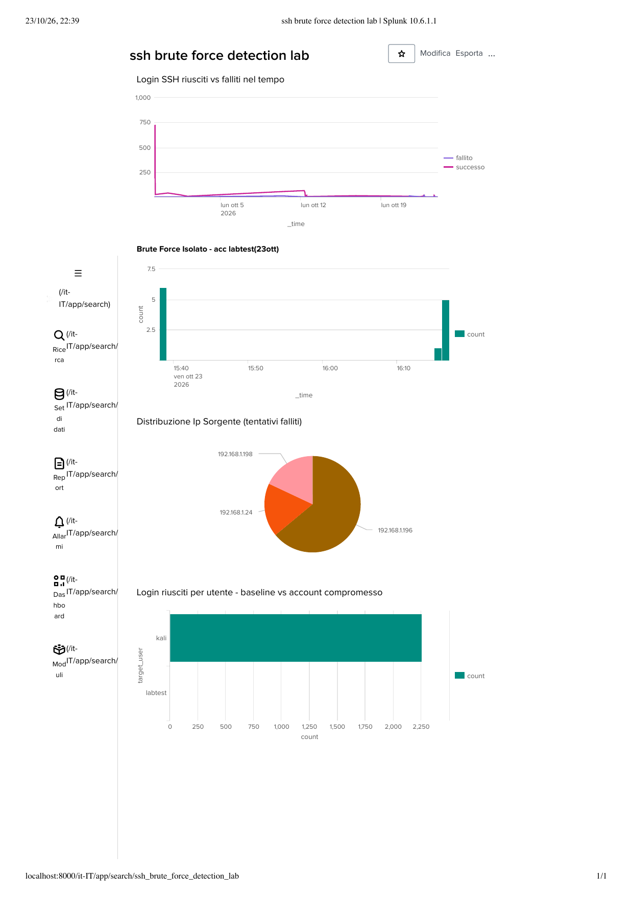

# SSH Brute Force Detection Lab — SIEM Log Analysis con Splunk

> ⚠️ **Disclaimer etico**: tutti i test offensivi contenuti in questo repository (brute force, enumerazione, exploitation, exfiltration simulata) sono stati eseguiti esclusivamente contro macchine di mia proprietà in laboratorio isolato (VM Kali Linux su rete privata, UTM). Nessun sistema di terzi è stato toccato. Gli account di test con password deboli usati per la fase di exploitation sono stati creati e rimossi nello stesso laboratorio, senza lasciare tracce permanenti. Non utilizzare queste tecniche contro sistemi di cui non si ha autorizzazione esplicita.

## 📌 Obiettivo

Costruire un ambiente SIEM funzionante da zero (Splunk Enterprise in locale) e usarlo per investigare, rilevare e documentare un attacco di tipo brute force su SSH — includendo l'intera catena di un attacco reale: ricognizione, enumerazione, exploitation, post-exploitation, exfiltration. L'obiettivo didattico è duplice: capacità offensiva (simulare un attacco realistico) e capacità difensiva (raccogliere log, scrivere query di detection, distinguere falsi positivi da vere minacce).

## 🧩 Contesto / Scenario

Laboratorio personale (vedi [home-lab-cybersecurity](https://github.com/luigiderosa2299-gif/home-lab-cybersecurity)): VM Kali Linux su UTM, rete privata domestica. Splunk Enterprise installato in locale sul Mac host (licenza Free, 500 MB/giorno). I log di autenticazione SSH della VM Kali sono stati esportati periodicamente da `journalctl` e caricati manualmente in Splunk per l'analisi.

## 🛠 Tecnologie e Strumenti

- **Splunk Enterprise** (locale, licenza Free) — raccolta, indicizzazione e query dei log (SPL)
- **Python 3** con [`paramiko`](https://www.paramiko.org/) — scripting del brute force e dell'exfiltration via SFTP
- **nmap** — reconnaissance ed enumeration (scansione porte, fingerprint versione SSH, algoritmi crittografici supportati)
- **NetExec** — tentativo di brute force su SMB (bloccato da hardening Windows, documentato come limite incontrato)
- **systemd journal** (`journalctl`) — fonte log nativa su Kali Linux (niente `/var/log/auth.log`, sistema solo-journal)
- Ambiente: VM Kali Linux (bersaglio/attaccante a seconda della fase) su UTM, rete privata `192.168.1.0/24`

## ⚙️ Cosa ho fatto

### 1. Setup e baseline
Installato Splunk Enterprise in locale, configurato l'ingestione dei log SSH della Kali VM. Caratterizzata la baseline del traffico "normale" (login via chiave pubblica, nessuna password, singola fonte abituale) prima di cercare anomalie.

### 2. Investigazione di anomalie storiche (falsi positivi)
Analizzati due episodi reali trovati nei log:
- Un pattern di login da un IP interno mai visto prima, risultato — dopo verifica del contesto — un altro dispositivo personale sulla stessa rete domestica (falso positivo confermato con sessioni riuscite successive dallo stesso IP)
- Un picco statistico di 641 login riusciti in 2 ore da una singola fonte, riconosciuto come traffico automatizzato legittimo (tooling di setup), non un attacco

Entrambi i casi documentati in [`docs/alert-ssh-login-investigation.md`](docs/alert-ssh-login-investigation.md) con playbook di triage in 5 passaggi: identificazione → raccolta contesto → valutazione → decisione → documentazione ([`docs/triage-playbook.md`](docs/triage-playbook.md)).

### 3. Simulazione di un attacco realistico (kill chain completa)
- **Reconnaissance**: `nmap -sV -p-` per scoprire porte e versioni dei servizi
- **Enumeration**: `ssh2-enum-algos` per analizzare gli algoritmi crittografici supportati (confermata configurazione SSH moderna e indurita — supporto a key exchange post-quantum)
- **Exploitation**: creato un account di test temporaneo con password debole ([`scripts/bruteforce_exploitation.py`](scripts/bruteforce_exploitation.py)), forzato con successo tramite dizionario di password comuni
- **Post-Exploitation**: eseguiti comandi di ricognizione post-accesso (`whoami`, `id`, `uname -a`), creato un file "sensibile" fittizio
- **Exfiltration**: trasferito il file fittizio fuori dalla macchina compromessa via SFTP ([`scripts/exfiltration_simulation.py`](scripts/exfiltration_simulation.py))
- **Cleanup**: rimosso l'account di test e ogni file temporaneo, nessuna traccia permanente lasciata sul sistema

### 4. Detection con Splunk (query SPL)
Scritte query SPL per rilevare il pattern di brute force, basate su finestre temporali (`bucket`/`timechart`) e soglie di tentativi falliti per unità di tempo. Query principale:
```spl
index=main host="kali*" "Failed password" earliest=0
| bucket _time span=1m
| stats count by _time
| where count >= 5
```
**Limite documentato onestamente**: le finestre temporali fisse possono "spezzare" un attacco a cavallo di un cambio di minuto, facendo sì che nessuna delle due finestre superi da sola la soglia. I SIEM professionali risolvono questo con finestre scorrevoli (sliding window) — limite noto, non nascosto nel report.

### 5. Script Python di supporto
- [`scripts/log_parser.py`](scripts/log_parser.py) — parser base che conta e filtra eventi di log per keyword
- [`scripts/bruteforce_simulation.py`](scripts/bruteforce_simulation.py) — simulazione iniziale di brute force (singolo utente, 10 password) usata per validare la query di detection
- [`scripts/bruteforce_exploitation.py`](scripts/bruteforce_exploitation.py) — exploitation completa contro account di test
- [`scripts/exfiltration_simulation.py`](scripts/exfiltration_simulation.py) — simulazione di esfiltrazione dati via SFTP

### 6. Dashboard Splunk
Costruita una dashboard con 4 pannelli: timeline login riusciti/falliti nel tempo, picco del brute force isolato per finestra temporale, distribuzione degli IP sorgente dei tentativi falliti (baseline vs falso positivo vs vero positivo), confronto login riusciti per utente (baseline `kali` vs account compromesso `labtest`).



## 🧱 Ostacoli incontrati (e come li ho risolti)

- **`journalctl`/`lastb` non esistono su macOS**: ogni esercizio di log reale va fatto sulla VM Linux via SSH, non sull'host Mac.
- **Kali minimale senza `rsyslog`**: niente `/var/log/auth.log`, solo journal systemd — filtrato con `journalctl -u ssh` invece che su file.
- **Paramiko non valida solo la password**: per default prova anche chiavi SSH disponibili (`look_for_keys=True`), restituendo falsi "successo". Risolto forzando `look_for_keys=False, allow_agent=False`.
- **Rockyou.txt non decodificabile da NetExec**: contiene byte non-UTF8 (lista di password reali trapelate). Risolto creando una wordlist pulita più piccola e mirata.
- **Hydra incompatibile con SMB moderno**: il modulo SMB di Hydra negozia ancora pensando a SMB1, mentre Windows 10/11 usa SMB2/3. Risolto passando a NetExec, strumento più moderno.
- **Windows 11 Home non supporta Desktop remoto in entrata**: limite di edizione, non di configurazione. Tentato un bersaglio alternativo (SMB) ma bloccato da hardening di rete più profondo (NetBIOS session setup) — documentato come limite di tempo incontrato, non risolto in questa iterazione.
- **`srclimit` di OpenSSH**: scoperta inattesa — il server SSH ha un meccanismo di difesa integrato che rallenta automaticamente le connessioni dopo tentativi falliti ravvicinati, osservato direttamente nei log durante i test.

## 🎯 Remediation consigliate

- Rate limiting/fail2ban sulle porte SSH esposte (oltre al `srclimit` nativo già osservato)
- MFA per account con accesso SSH critico
- Alert SIEM con soglia dinamica o sliding window, non solo bucket fissi
- Disabilitare completamente l'autenticazione a password su SSH dove non necessaria (solo chiave, come già configurato su questo lab)
